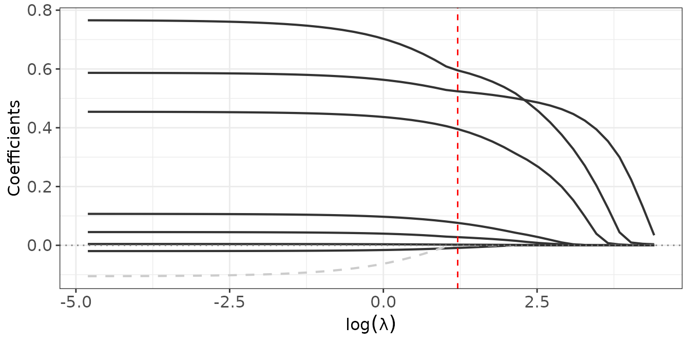
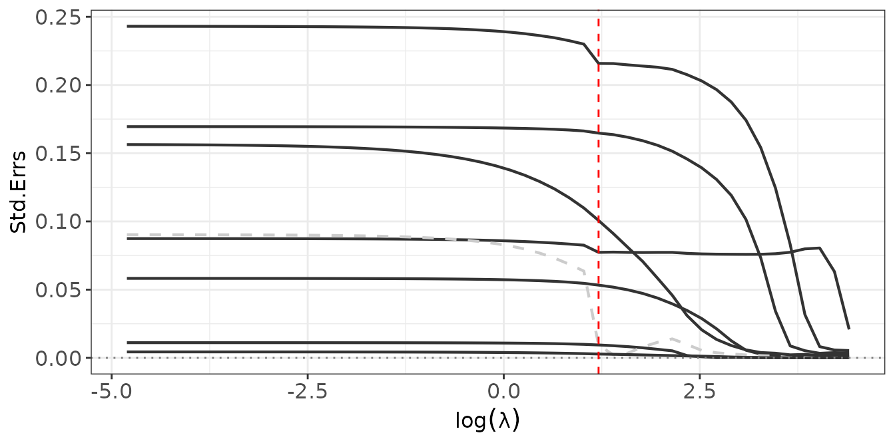
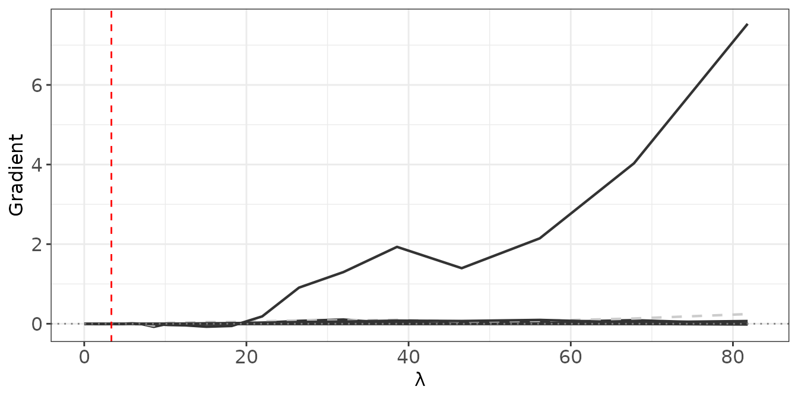

# An Introduction to islasso

## Abstract

In this short note we present and briefly discuss the R package islasso
dealing with regression models having a large number of covariates.
Estimation is carried out by penalizing the coefficients via a
quasi-lasso penalty, wherein the nonsmooth lasso penalty is replaced by
its smooth counterpart determined iteratively by data according to the
induced smoothing idea. The package includes functions to estimate the
model and to test for linear hypothesis on linear combinations of
relevant coefficients. We illustrate R code throughout a worked example,
by avoiding intentionally to report details and extended bibliography.

## Introduction

Let \mathbf{y} = \mathbf{X}\beta + \mathbf{\epsilon} be the linear model
of interest with usual zero-means and homoscedastic errors. As usual,
\mathbf{y} = (y_1,\ldots,y_n)^T is the response vector, \mathbf{X} is
the n \times p design matrix (having p quite large) with regression
coefficients \mathbf{\beta}. When interest lies in selecting the
non-noise covariates and estimating the relevant effect, one assumes the
lasso penalized objective function (Tibshirani, 1996),
\frac{1}{2}\|\|\mathbf{y}-\mathbf{X}\mathbf{\beta}\|\|\_2^2+\lambda\|\|\mathbf{\beta}\|\|\_1

## The R functions

The main function of the package are *islasso()* where the user supplies
the model formula as in the usual *lm* or *glm* functions, i.e.

``` r

islasso(formula, family = gaussian, lambda, alpha = 1, data, weights, subset,
        offset, unpenalized, contrasts = NULL, control = is.control())
```

and *islasso.path* used to fit the regularization path via the induced
smoothed lasso framework, i.e.

``` r

islasso.path(formula, family = gaussian, lambda = NULL, nlambda = 100, 
             lambda.min.ratio = ifelse(nobs < nvars, 1E-2, 1E-04), alpha = 1, 
             data, weights, subset, offset, unpenalized, contrasts = NULL, control = is.control())
```

*family* accepts specification of family and link function as in Table
1, *lambda* is the tuning parameter, *alpha* is elastic-net mixing
parameter, *nlambda* is the number of lambda values, *lambda.min.ratio*
is the smallest value for lambda (as a fraction of lambda.max), and
*unpenalized* allows to indicate covariates with unpenalized
coefficients.

**Table 1. Some families and link functions available in islasso** (from
version 1.7.0 any family object accepted by
[`glm()`](https://rdrr.io/r/stats/glm.html) can be used; see the
vignette *GLMs and families*)

| family                           |                 link                 |
|:---------------------------------|:------------------------------------:|
| gaussian                         |               identity               |
| binomial, quasibinomial          | logit, probit, cauchit, log, cloglog |
| poisson, quasipoisson            |         log, identity, sqrt          |
| Gamma                            |        inverse, identity, log        |
| inverse.gaussian                 |    1/mu^2, inverse, identity, log    |
| `MASS::negative.binomial(theta)` |         log, sqrt, identity          |

The fitter functions are and which read as

``` r

islasso.fit(X, y, family = gaussian(), lambda, alpha = 1, intercept = FALSE, 
            weights = NULL, offset = NULL, unpenalized = NULL, control = is.control()) 
```

and

``` r

islasso.path.fit(X, y, family = gaussian(), lambda, nlambda, lambda.min.ratio, 
                 alpha = 1, intercept = FALSE, weights = NULL, offset = NULL, 
                 unpenalized = NULL, control = is.control()) 
```

which actually implement the estimating algorithm as described in the
paper. The *lambda* argument in *islasso.fit* and *islasso* specifies
the positive tuning parameter in the penalized objective. Any
non-negative value can be provided, but if missing, it is computed via
K-fold cross validation by the function *cv.glmnet()* from package
**glmnet**. The number of folds being used can be specified via the
argument *nfolds* of the auxiliary function *is.control()*. The *lambda*
argument in *islasso.path.fit* and *islasso.path* specifies the sequence
of positive tuning parameters, user supplied or automatically computed
based on *nlambda* and *lambda.min.ratio*.

## A worked example: the Prostate data set

The `Prostate` dataset is a well-known benchmark in regression analysis
and variable selection, originally published by Stamey et al. (1989). It
contains clinical measurements from 97 male patients diagnosed with
prostate cancer.

The primary goal is to model the level of **prostate-specific antigen
(PSA)** based on several predictive variables, including:

- `lcavol`: log cancer volume  
- `lweight`: log prostate weight  
- `age`: patient’s age  
- `lbph`: log benign prostatic hyperplasia amount  
- `svi`: seminal vesicle invasion  
- `lcp`: log capsular penetration  
- `gleason`: Gleason score (histological grade of tumor)  
- `pgg45`: percent of Gleason scores 4 or 5

The response variable is `lpsa`, the logarithm of PSA levels.

This dataset is particularly useful for testing due to its moderate size
and the presence of multicollinearity among predictors.

To select the important terms in the regression equation we could simply
apply the lasso using the R package **glmnet**

``` r

library(islasso)

data("Prostate", package = "islasso")
x <- model.matrix(lpsa ~ ., data = Prostate)[, -1]
y <- Prostate$lpsa
set.seed(1)
a1 <- glmnet::cv.glmnet(x, y, family = "gaussian")
n <- nrow(Prostate)
a1$lambda.min * n
#> [1] 7.283069

b <- drop(coef(a1, "lambda.min", exact = TRUE))
length(b[b != 0])
#> [1] 6
```

Ten-fold cross-validation “selects” \lambda= 7.283. corresponding to 6
non null coefficients

``` r

names(b[b != 0])
#> NULL
```

The last three estimates are

``` r

tail(b[b != 0], n = 3)
#> [1] 0.042120029 0.543559468 0.001225954
```

A reasonable question is if all the “selected” coefficients are
significant in the model. Unfortunately lasso regression does not return
standard errors due to nonsmoothness of objective, and some alternative
approaches have been proposed., including the (Lockhart et al., 2013).
Among the (few) strategies, including the ‘covariance test’, the
‘post-selection inference’ and the ‘(modified) residual bootstrap’, here
we illustrate the R package **islasso** implementing the recent \`quasi’
lasso approach based on the induced smoothing idea (Brown and Wang,
2005) as discussed in Cilluffo et al. (2020).

While the optimal lambda could be selected (without supplying any value
to *lambda*), we use optimal value minimizing a specific criterion
chosen between AIC, BIC, AICc, eBIC, GCV or GIC. From version 1.4.0 of
the R package **islasso** optimal strategy is to built the
regularization path

``` r

out <- islasso.path(lpsa ~ ., data = Prostate, nlambda = 50L, family = gaussian())
out
#> 
#> Call:
#> islasso.path(formula = lpsa ~ ., family = gaussian(), nlambda = 50L, 
#>     data = Prostate)
#> 
#> Coefficients:
#>     lambda     df    phi deviance    logLik
#> 1   0.0082 8.9982 0.5018  44.1631  -99.4762
#> 2   0.0099 8.9978 0.5018  44.1631  -99.4763
#> 3   0.0119 8.9973 0.5018  44.1632  -99.4763
#> 4   0.0144 8.9968 0.5018  44.1632  -99.4763
#> 5   0.0174 8.9961 0.5018  44.1632  -99.4763
#> 6   0.0209 8.9953 0.5018  44.1632  -99.4763
#> 7   0.0253 8.9943 0.5018  44.1632  -99.4764
#> 8   0.0305 8.9931 0.5018  44.1633  -99.4764
#> 9   0.0368 8.9916 0.5018  44.1634  -99.4765
#> 10  0.0444 8.9899 0.5018  44.1635  -99.4766
#> 11  0.0536 8.9878 0.5018  44.1637  -99.4768
#> 12  0.0647 8.9852 0.5018  44.1639  -99.4771
#> 13  0.0781 8.9821 0.5018  44.1643  -99.4775
#> 14  0.0942 8.9784 0.5017  44.1648  -99.4780
#> 15  0.1137 8.9738 0.5017  44.1655  -99.4789
#> 16  0.1372 8.9682 0.5017  44.1666  -99.4800
#> 17  0.1656 8.9615 0.5017  44.1682  -99.4818
#> 18  0.1998 8.9532 0.5017  44.1705  -99.4843
#> 19  0.2411 8.9431 0.5017  44.1738  -99.4879
#> 20  0.2910 8.9306 0.5016  44.1786  -99.4932
#> 21  0.3511 8.9153 0.5016  44.1855  -99.5008
#> 22  0.4237 8.8965 0.5016  44.1955  -99.5118
#> 23  0.5114 8.8731 0.5017  44.2099  -99.5275
#> 24  0.6171 8.8439 0.5017  44.2306  -99.5502
#> 25  0.7447 8.8075 0.5019  44.2601  -99.5827
#> 26  0.8987 8.7618 0.5021  44.3023  -99.6288
#> 27  1.0846 8.7042 0.5024  44.3619  -99.6940
#> 28  1.3089 8.6312 0.5030  44.4456  -99.7855
#> 29  1.5796 8.5389 0.5037  44.5618  -99.9121
#> 30  1.9062 8.4226 0.5049  44.7207 -100.0848
#> 31  2.3004 8.2770 0.5065  44.9338 -100.3153
#> 32  2.7761 8.0994 0.5086  45.2124 -100.6151
#> 33  3.3502 7.3572 0.5069  45.4441 -100.8630
#> 34  4.0429 7.1029 0.5083  45.6969 -101.1321
#> 35  4.8790 6.9028 0.5110  46.0441 -101.4992
#> 36  5.8879 6.6977 0.5150  46.5098 -101.9872
#> 37  7.1055 6.4217 0.5202  47.1203 -102.6197
#> 38  8.5749 6.0975 0.5269  47.8939 -103.4095
#> 39 10.3481 5.4535 0.5322  48.7192 -104.2381
#> 40 12.4880 5.0093 0.5419  49.8504 -105.3514
#> 41 15.0704 4.5590 0.5566  51.4513 -106.8844
#> 42 18.1869 4.1197 0.5780  53.6819 -108.9428
#> 43 21.9478 3.6515 0.6070  56.6602 -111.5615
#> 44 26.4864 3.2212 0.6459  60.5682 -114.7964
#> 45 31.9636 2.7885 0.6983  65.7891 -118.8066
#> 46 38.5735 2.4083 0.7638  72.2524 -123.3516
#> 47 46.5502 2.1679 0.8486  80.4752 -128.5791
#> 48 56.1764 2.0042 0.9587  91.0767 -134.5811
#> 49 67.7933 1.7450 1.0967 104.4704 -141.2354
#> 50 81.8125 1.2582 1.2654 121.1522 -148.4204
```

and then to choose the best tuning parameter through the one of the
criteria listed above using the function *GoF.islasso.path*, e.g.,

``` r

lmb.best <- GoF.islasso.path(out, plot = FALSE)
lmb.best$lambda.min
#>       AIC       BIC      AICc      eBIC       GCV       GIC 
#>  3.350151 10.348092  4.042937 12.488001  4.042937  4.042937
```

The regularization path is also very useful to have more insights about
coefficients, standard errors and gradient profile

``` r

plot(out, yvar = "coefficients", gof = "AIC")
```



``` r

plot(out, yvar = "se", gof = "AIC")
```



``` r

plot(out, yvar = "gradient", gof = "AIC")
```



Once selected the best lambda value minimizing for example the AIC
criterion, the last step of the strategy consists on fitting a new
islasso model.

``` r

lambda.aic <- lmb.best$lambda.min["AIC"]
out2 <- islasso(lpsa ~ ., data = Prostate, lambda = lambda.aic, family = gaussian())
out2
#> 
#> Call:
#> islasso(formula = lpsa ~ ., family = gaussian(), lambda = lambda.aic, 
#>     data = Prostate)
#> 
#> Coefficients:
#> (Intercept)       lcavol      lweight          age         lbph          svi  
#>    0.510792     0.523953     0.395643    -0.008836     0.076335     0.595210  
#>         lcp      gleason        pgg45  
#>    0.000000     0.027789     0.002267  
#> 
#> Degrees of Freedom: 96 Total (i.e. Null); 89.64 Residual
#> Null Deviance: 127.9 
#> Residual Deviance: 45.44 
#> AIC: 218.4 
#> Lambda: 3.35
```

The **summary** method quickly returns the main output of the fitted
model, including point estimates, standard errors and p-values.
Visualizing estimates for all covariates could be somewhat inconvenient,
especially when the number of covariates is large, thus we decide to
print estimates only if the pvalue is less than a threshold value. We
use *0.10*

``` r

summary(out2, pval = 0.10)
#> 
#> Call:
#> islasso(formula = lpsa ~ ., family = gaussian(), lambda = lambda.aic, 
#>     data = Prostate)
#> 
#> Residuals:
#>      Min       1Q   Median       3Q      Max 
#> -1.68057 -0.38381  0.00979  0.39264  1.51820 
#> 
#>             Estimate Std. Error    Df z value Pr(>|z|)    
#> (Intercept)  0.51079    0.99818 1.000   0.512  0.60884    
#> lcavol       0.52395    0.07733 1.000   6.775 1.24e-11 ***
#> lweight      0.39564    0.16474 0.988   2.402  0.01632 *  
#> svi          0.59521    0.21581 0.994   2.758  0.00582 ** 
#> ---
#> Signif. codes:  0 '***' 0.001 '**' 0.01 '*' 0.05 '.' 0.1 ' ' 1
#> 
#> (Dispersion parameter for gaussian family taken to be 0.5069469)
#> 
#>     Null deviance: 127.918  on 96.00  degrees of freedom
#> Residual deviance:  45.444  on 89.64  degrees of freedom
#> AIC: 218.44
#> Lambda: 3.3502
#> 
#> Number of IS iterations: 34
```

In addition to the usual information printed by the summary method, the
output also includes the column *Df* representing the degrees of freedom
of each coefficient. Their sum is used to quantify the model complexity

``` r

sum(out2$internal$hi)
#> [1] 7.357227
```

and the corresponding residual degrees of freedom (89.64) as reported
above. The Wald test (column *z value*) and p-values can be used to
assess important or significant covariates. Results suggest that
variables `lcavol`, `lweight` and `svi` are informative to predict the
measure of the logarithm of PSA levels, while `lbph` is borderline
informative. Just to be clear, another way to obtain a similar result
without computing the regularization path, is to use the function
*aic.islasso* which requires a preliminary islasso fit object and a
specification of the criterion to be used. Hence

``` r

lambda.aic2 <- aic.islasso(out2, method = "AIC", interval = c(.1, 50), trace = FALSE)
out3 <- update(out2, lambda = lambda.aic2)
summary(out3, pval = .10)
#> 
#> Call:
#> islasso(formula = lpsa ~ ., family = gaussian(), lambda = lambda.aic2, 
#>     data = Prostate)
#> 
#> Residuals:
#>      Min       1Q   Median       3Q      Max 
#> -1.67474 -0.38070  0.00746  0.38965  1.52421 
#> 
#>             Estimate Std. Error    Df z value Pr(>|z|)    
#> (Intercept)  0.50016    0.98317 1.000   0.509   0.6109    
#> lcavol       0.52294    0.07743 1.000   6.754 1.44e-11 ***
#> lweight      0.39215    0.16450 0.986   2.384   0.0171 *  
#> svi          0.59212    0.21590 0.994   2.743   0.0061 ** 
#> ---
#> Signif. codes:  0 '***' 0.001 '**' 0.01 '*' 0.05 '.' 0.1 ' ' 1
#> 
#> (Dispersion parameter for gaussian family taken to be 0.5072506)
#> 
#>     Null deviance: 127.918  on 96.00  degrees of freedom
#> Residual deviance:  45.514  on 89.73  degrees of freedom
#> AIC: 218.42
#> Lambda: 3.5527
#> 
#> Number of IS iterations: 39
```

Comparisons between methods to select the tuning parameter and further
discussions are out of the scope of this short note. We conclude this
note by emphasizing that **islasso** also accepts the so-called
elastic-net penalty, such that \frac{1}{2}\|\|\mathbf{y}-
\mathbf{X\beta}\|\|\_2^{2}+\lambda \\ \alpha \|\|\mathbf{\beta}
\|\|^{}\_1 + \frac{1}{2}(1-\alpha) \|\|\mathbf{\beta} \|\|^{2}\_2 \\
where 0\le \alpha\le 1 is the mixing parameter to be specified in
*islasso()* and *islasso.path()* via the argument *alpha*, e.g.

``` r

# update the islasso path to fit an elastic-net model
out4 <- update(out, alpha = .5)
out4
#> 
#> Call:
#> islasso.path(formula = lpsa ~ ., family = gaussian(), nlambda = 50L, 
#>     alpha = 0.5, data = Prostate)
#> 
#> Coefficients:
#>      lambda     df    phi deviance    logLik
#> 1    0.0164 8.9968 0.5018  44.1631  -99.4763
#> 2    0.0197 8.9961 0.5018  44.1632  -99.4763
#> 3    0.0238 8.9953 0.5018  44.1632  -99.4763
#> 4    0.0288 8.9943 0.5018  44.1632  -99.4763
#> 5    0.0347 8.9931 0.5018  44.1632  -99.4763
#> 6    0.0419 8.9917 0.5018  44.1633  -99.4764
#> 7    0.0505 8.9900 0.5018  44.1633  -99.4764
#> 8    0.0610 8.9879 0.5018  44.1634  -99.4765
#> 9    0.0736 8.9854 0.5018  44.1635  -99.4767
#> 10   0.0888 8.9823 0.5018  44.1637  -99.4769
#> 11   0.1072 8.9786 0.5017  44.1640  -99.4772
#> 12   0.1294 8.9742 0.5017  44.1644  -99.4776
#> 13   0.1561 8.9688 0.5017  44.1650  -99.4782
#> 14   0.1884 8.9623 0.5017  44.1658  -99.4791
#> 15   0.2274 8.9544 0.5016  44.1670  -99.4805
#> 16   0.2744 8.9449 0.5016  44.1687  -99.4824
#> 17   0.3311 8.9333 0.5016  44.1712  -99.4851
#> 18   0.3996 8.9193 0.5015  44.1749  -99.4891
#> 19   0.4822 8.9023 0.5015  44.1801  -99.4949
#> 20   0.5819 8.8815 0.5015  44.1877  -99.5032
#> 21   0.7023 8.8563 0.5014  44.1985  -99.5151
#> 22   0.8475 8.8255 0.5014  44.2141  -99.5322
#> 23   1.0227 8.7879 0.5015  44.2363  -99.5566
#> 24   1.2342 8.7418 0.5016  44.2679  -99.5912
#> 25   1.4895 8.6854 0.5018  44.3125  -99.6400
#> 26   1.7975 8.6161 0.5021  44.3750  -99.7083
#> 27   2.1692 8.5310 0.5026  44.4618  -99.8031
#> 28   2.6178 8.4267 0.5033  44.5810  -99.9329
#> 29   3.1591 8.2994 0.5044  44.7421 -100.1079
#> 30   3.8124 8.1455 0.5059  44.9559 -100.3391
#> 31   4.6008 7.9631 0.5080  45.2335 -100.6376
#> 32   5.5522 7.2061 0.5062  45.4569 -100.8767
#> 33   6.7003 6.9521 0.5076  45.7119 -101.1480
#> 34   8.0859 6.8306 0.5108  46.0614 -101.5174
#> 35   9.7580 6.6454 0.5150  46.5336 -102.0121
#> 36  11.7759 6.5531 0.5219  47.2070 -102.7089
#> 37  14.2110 6.1580 0.5292  48.0703 -103.5878
#> 38  17.1497 5.5519 0.5363  49.0426 -104.5590
#> 39  20.6962 5.1579 0.5470  50.2331 -105.7222
#> 40  24.9760 4.7561 0.5624  51.8773 -107.2843
#> 41  30.1409 4.3973 0.5846  54.1372 -109.3524
#> 42  36.3738 3.9978 0.6150  57.1960 -112.0180
#> 43  43.8956 3.5509 0.6551  61.2213 -115.3166
#> 44  52.9729 3.1104 0.7074  66.4174 -119.2676
#> 45  63.9273 2.6860 0.7746  73.0565 -123.8884
#> 46  77.1470 2.2847 0.8573  81.2016 -129.0149
#> 47  93.1004 2.0006 0.9545  90.6759 -134.3672
#> 48 112.3529 1.7290 1.0693 101.8750 -140.0153
#> 49 135.5866 1.4590 1.1842 113.1390 -145.1015
#> 50 163.6249 1.1610 1.2929 123.9138 -149.5135

# select the best tuning parameter
lmb.best2 <- GoF.islasso.path(out4, plot = FALSE)
lmb.best2$lambda.min
#>       AIC       BIC      AICc      eBIC       GCV       GIC 
#>  5.552156  6.700302  6.700302 20.696184  6.700302  6.700302

# fit a new islasso model with elastic-net penalty
lambda.aic3 <- lmb.best2$lambda.min["AIC"]
out5 <- update(out2, alpha = .5, lambda = lambda.aic3)
summary(out5, pval = .10)
#> 
#> Call:
#> islasso(formula = lpsa ~ ., family = gaussian(), lambda = lambda.aic3, 
#>     alpha = 0.5, data = Prostate)
#> 
#> Residuals:
#>      Min       1Q   Median       3Q      Max 
#> -1.67591 -0.37692  0.02177  0.39139  1.53096 
#> 
#>             Estimate Std. Error    Df z value Pr(>|z|)    
#> (Intercept)  0.47616    0.98734 1.000   0.482  0.62961    
#> lcavol       0.50862    0.07346 0.955   6.924 4.39e-12 ***
#> lweight      0.40181    0.15898 0.956   2.527  0.01149 *  
#> svi          0.60711    0.20552 0.954   2.954  0.00314 ** 
#> ---
#> Signif. codes:  0 '***' 0.001 '**' 0.01 '*' 0.05 '.' 0.1 ' ' 1
#> 
#> (Dispersion parameter for gaussian family taken to be 0.5062361)
#> 
#>     Null deviance: 127.918  on 96.00  degrees of freedom
#> Residual deviance:  45.457  on 89.79  degrees of freedom
#> AIC: 218.17
#> Lambda: 5.5522
#> 
#> Number of IS iterations: 37

# or select the best tuning parameter using AIC with an islasso object
lambda.aic4 <- aic.islasso(out5, method = "AIC", interval = c(.1, 100), trace = FALSE)
out6 <- update(out5, lambda = lambda.aic4)
summary(out6, pval = .10)
#> 
#> Call:
#> islasso(formula = lpsa ~ ., family = gaussian(), lambda = lambda.aic4, 
#>     alpha = 0.5, data = Prostate)
#> 
#> Residuals:
#>      Min       1Q   Median       3Q      Max 
#> -1.66090 -0.38508  0.00922  0.38634  1.54766 
#> 
#>             Estimate Std. Error    Df z value Pr(>|z|)    
#> (Intercept)  0.44806    0.95112 1.000   0.471  0.63758    
#> lcavol       0.50401    0.07301 0.950   6.903 5.09e-12 ***
#> lweight      0.39406    0.15756 0.949   2.501  0.01238 *  
#> svi          0.60112    0.20409 0.949   2.945  0.00323 ** 
#> ---
#> Signif. codes:  0 '***' 0.001 '**' 0.01 '*' 0.05 '.' 0.1 ' ' 1
#> 
#> (Dispersion parameter for gaussian family taken to be 0.507113)
#> 
#>     Null deviance: 127.92  on 96  degrees of freedom
#> Residual deviance:  45.64  on 90  degrees of freedom
#> AIC: 218.14
#> Lambda: 6.3929
#> 
#> Number of IS iterations: 70
```

## References

- Tibshirani R. *Regression shrinkage and selection via the lasso*. J R
  Stat Soc: Series B 1996; 58: 267–288
- Cilluffo, G, Sottile, G, La Grutta, S and Muggeo, VMR (2020) *The
  Induced Smoothed lasso: A practical framework for hypothesis testing
  in high dimensional regression*. Statistical Methods in Medical
  Research 29(3): 765–777. doi: 10.1177/0962280219842890.
- Brown B and Wang Y. *Standard errors and covariance matrices for
  smoothed rank estimators*. Biometrika 2005; 92: 149–158.
